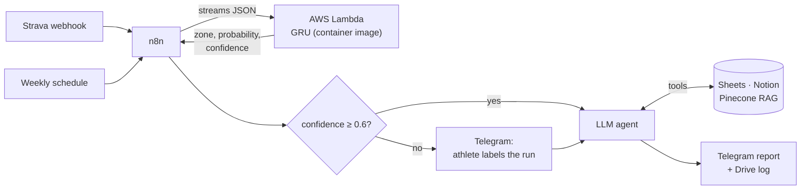
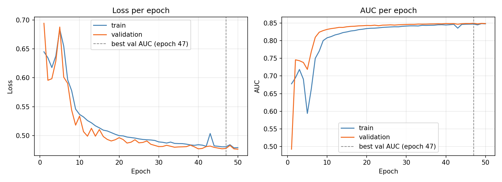
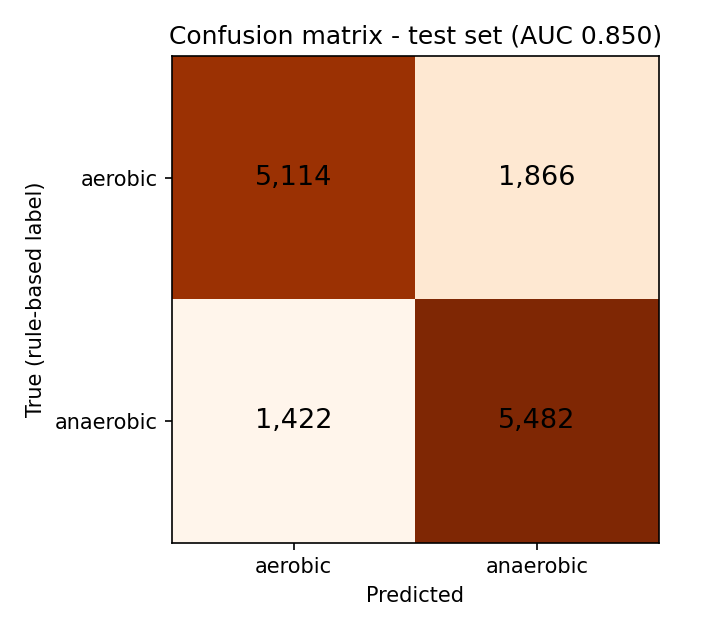

# RunSight — an AI running coach, end to end

[](https://github.com/vyscnktn/runsight-ai-running-coach/actions/workflows/ci.yml)


RunSight turns a Strava workout into personalised coaching feedback. A **GRU network** classifies the session as aerobic or anaerobic from the raw sensor signal, an **LLM agent** (with RAG and tools) writes the coaching report around that result, and **n8n** orchestrates everything — including a human-in-the-loop step when the model is unsure.

> Built as the final project of an AI engineering bootcamp, then reworked into a standalone portfolio project.
> Pipeline: **deep-learning model → LLM agent → workflow automation**.



## What is in here

| Part | What it does | Where |
|---|---|---|
| **Labelling method** | Rule-based, physiologically motivated aerobic/anaerobic label per workout, derived from the athlete's own heart-rate range | [`training/functions.py`](training/functions.py), [docs/labeling-method.md](docs/labeling-method.md) |
| **GRU classifier** | Predicts that label from a single workout's raw signal (speed, heart rate, altitude, GPS) — no history needed | [`training/`](training), [docs/model-card.md](docs/model-card.md) |
| **Serving** | Keras model in a Docker image on AWS Lambda | [`deploy/`](deploy) |
| **LLM agents** | Onboarding, post-workout coaching and weekly review agents with fixed JSON output schemas and runtime-loaded prompts | [`prompts/`](prompts), [`schemas/`](schemas) |
| **RAG** | Pinecone knowledge base of sports-science sources, exposed to the agent as a tool | [`rag/SOURCES.md`](rag/SOURCES.md) |
| **Automation** | 80-node n8n workflow (post-workout, onboarding, RAG ingestion, weekly learning loop) | [`n8n/`](n8n) |
| **Tests / CI** | Scenario tests for labelling and QC; workflow and notebook hygiene checks | [`tests/`](tests), [`.github/`](.github) |

## Results

Test set of 13,884 workouts (6,980 aerobic / 6,904 anaerobic), split per workout:

| Metric | Value |
|---|---|
| ROC AUC | **0.850** |
| Accuracy | 0.76 |
| Precision / recall — aerobic | 0.78 / 0.73 |
| Precision / recall — anaerobic | 0.75 / 0.79 |
| Chance / majority-class baseline | AUC 0.50, accuracy ≈ 0.50 |



Train and validation curves track each other (best validation AUC 0.849 at epoch 47; no early stopping triggered), so there is no sign of overfitting.

### How to read these numbers — honestly

* **The labels come from the rule-based pipeline**, not from a lab test. The metrics measure how faithfully the GRU reproduces that rule from a single workout's raw signal — they are *not* agreement with an independent physiological ground truth.
* **The split is per workout, not per athlete.** The same athlete can appear in train and test, so the scores say nothing yet about *new users*. This was a deliberate trade-off (stable, representative evaluation over a very uneven number of workouts per user); a user-grouped evaluation is the obvious next step. See [docs/design-decisions.md](docs/design-decisions.md).
* **Errors are concentrated where the rule itself is fuzzy.** The error rate peaks at ~45 % for workouts that spend only 1–2 % of their time above the threshold (right at the 0.02 label cutoff) and falls to 12–19 % for clearly anaerobic sessions (> 10 % above threshold). Overall error is 23.7 % (3,288 of 13,884). Because 41 % of the data is fully aerobic (error rate 23 %), most absolute errors still come from that group.



*(Full numbers: [`docs/results/test_metrics.json`](docs/results/test_metrics.json). [`training/9_gru_evaluate.ipynb`](training/9_gru_evaluate.ipynb) regenerates the ROC curve, the confusion matrix and the error-rate-by-distance plot from a trained model.)*

## How it works

### 1. Labelling: a personal threshold instead of `220 − age`

The dataset ([EndomondoHR / FitRec](https://cseweb.ucsd.edu/~jmcauley/datasets/fitrec.html)) contains no age, so the usual max-heart-rate formulas are not available. Instead each athlete's own history defines the reference — a data-driven cousin of the Karvonen heart-rate-reserve idea:

```
floor     = lowest  p10 heart rate across all of the athlete's workouts
ceiling   = highest p95 heart rate across all of the athlete's workouts
threshold = floor + 0.70 × (ceiling − floor)

anaerobic_time_frac = share of the workout spent above the threshold
label = "anaerobik" if anaerobic_time_frac > 0.02 else "aerobik"
```

`0.70` approximates the **aerobic threshold (VT1)**, the boundary that matters for a below/above-threshold split in polarised training (Seiler, 2010). `0.85` (≈ lactate threshold, VT2) was tried and rejected: sustained tempo efforts sit below it and would be mislabelled aerobic — this failure is pinned down by a unit test (`test_threshold_070_catches_tempo_but_085_does_not`). Clustering (K-Means/GMM) was explored first and dropped, because the meaningful split can be computed directly from a physiologically grounded signal. Details: [docs/labeling-method.md](docs/labeling-method.md).

> The label strings `aerobik` / `anaerobik` (and the QC reason codes) are Turkish-named on purpose: they are the contract between the model, the n8n workflow and the agent prompts.

### 2. Model: distilling the rule into a GRU

The rule needs the athlete's *whole history*, so it cannot label a first-ever workout. The GRU learns to predict the same label from one workout alone:

* **Input:** 4 channels × 500 time steps — speed, heart rate, altitude, and GPS reduced to one axis (local metres → PCA, 1 component). Each channel has its own `MinMaxScaler`, fitted on the training split only.
* **Search:** Keras Tuner `RandomSearch`, 10 trials, objective `val_auc` → `units 64/16, dropout 0.1/0.5, no L2, lr 1e-3`.
* **Output:** sigmoid probability of "anaerobic"; `confidence = |p − 0.5| × 2`.

GRU rather than LSTM for a lighter model — relevant for a serverless, cost-conscious deployment. See [docs/model-card.md](docs/model-card.md).

### 3. Serving: a container on Lambda

[`deploy/handler.py`](deploy/handler.py) receives the Strava streams response unchanged, resamples to 500 points, applies the saved scalers and returns:

```json
{ "training_zone": "anaerobik", "anaerobic_probability": 0.83, "confidence": 0.66,
  "hr_p10": 128.0, "hr_p95": 170.0 }
```

`hr_p10` / `hr_p95` are returned so that the personal floor/ceiling can later be recalibrated from the athlete's history (not yet wired into the weekly loop — see Limitations).

### 4. Agents, RAG and human-in-the-loop

* Three LangChain agents in n8n (onboarding, post-workout, weekly review). Output is pinned by a JSON Schema via a Structured Output Parser, so downstream nodes always find the same fields.
* **Prompts are fetched at run time** from this repository (`prompts/*.md`), so changing agent behaviour is a `git push`, not an n8n edit.
* Deterministic work is done in code nodes, not by the LLM: training-plan week/day arithmetic, Karvonen zones, and cardiac drift (an efficiency-factor comparison of the two halves of the run).
* **Confidence routing:** `confidence ≥ 0.6` is accepted automatically; below that the athlete is asked on Telegram (`sendAndWait`) and the *human's* label is stored — which also builds a verified-label set for future fine-tuning.
* **RAG:** Pinecone (serverless, 1536-d, cosine) with OpenAI embeddings, attached to the agent as a `knowledge_base` tool. Sources: [`rag/SOURCES.md`](rag/SOURCES.md).

More in [docs/architecture.md](docs/architecture.md) and [n8n/README.md](n8n/README.md).

## Repository layout

```
├── training/        notebooks 1–7, 9 + functions.py   (data → labels → GRU → evaluation)
├── deploy/          Dockerfile, Lambda handler, model + scalers
├── n8n/             sanitised workflow export + import guide
├── prompts/         agent system prompts (loaded at run time; written in Turkish)
├── schemas/         JSON Schemas for the agents' structured outputs
├── rag/             sources of the knowledge base
├── scripts/         sample-event generator, figure builder, workflow sanitiser
├── tests/           scenario tests (labelling, QC, sanitiser)
└── docs/            architecture, labelling method, model card, design decisions, results
```

## Quick start

```bash
# 1. Tests (no TensorFlow needed)
pip install numpy pandas matplotlib
python -m unittest discover -s tests -v

# 2. Try the Lambda handler locally (needs deploy/requirements.txt)
pip install -r deploy/requirements.txt
python scripts/make_sample_event.py > sample_streams.json
cd deploy && python handler.py ../sample_streams.json

# 3. Retrain: see training/README.md (dataset is not included)
```

Deploying the container and importing the workflow: [deploy/README.md](deploy/README.md), [n8n/README.md](n8n/README.md).

## Limitations and next steps

* **Fidelity, not ground truth** — see above. Next: validate the labels against lactate/field-test data or expert-annotated runs.
* **No per-athlete evaluation yet** — re-run the evaluation with a user-grouped split to quantify generalisation to unseen athletes.
* **Multi-tenant:** the Strava webhook fires per app, but API calls currently use one developer OAuth credential; production needs a per-athlete token store.
* **Threshold auto-calibration** from the returned `hr_p10` / `hr_p95` is designed but not yet part of the weekly learning loop.
* **Cardiac drift** (`hr_drift_pct`) is reliable for steady runs; for progression runs it can flag a physiologically normal heart-rate rise. The prompt asks for cautious interpretation; there is no algorithmic correction yet.
* The agent's "Karvonen zones" (age + resting HR) are a separate, textbook calculation and do not equal the GRU's data-driven personal threshold.
* **Language:** the agent prompts and the chat messages are in Turkish (the target user's language); the n8n node names are Turkish too. Code, documentation and notebooks are in English.

## Data, credits and licence

* Training data: EndomondoHR / FitRec — Ni, Muhlstein & McAuley, *Modeling Heart Rate and Activity Data for Personalized Fitness Recommendation*, WWW 2019. **Not redistributed here**; download it from the project page and follow its terms.
* Background: Seiler (2010), *What is best practice for training intensity and duration distribution in endurance athletes?* IJSPP 5(3).
* Code: [MIT](LICENSE).

---

*Built by [@vyscnktn](https://github.com/vyscnktn).*
