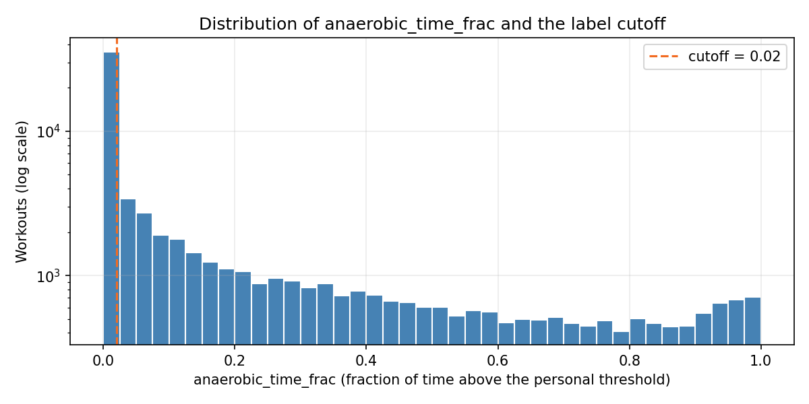

# Labelling method

The training label is **not** hand-annotated. It is computed by a deterministic, physiologically motivated pipeline in [`training/functions.py`](../training/functions.py) (`run_zone_pipeline`).

## Steps

1. **Quality control (`qc_row`)** — a workout is dropped if it is shorter than 10 min or longer than 300 min, if more than 20 % of speed values are invalid (valid: 1–30 km/h), or if fewer than 50 % of heart-rate values are valid (valid: 60–220 bpm). Invalid values become `NaN` and are filled by linear interpolation, which preserves time alignment. Reason codes: `cok_kisa`, `cok_uzun`, `bozuk_timestamp`, `hiz_cok_eksik`, `hr_cok_eksik`.
2. **Features** — scale-free or time-normalised measures only (speed CV, surge rate per minute, pace/HR drift, HR percentiles), because the 500 samples are spread over the whole workout and consecutive-sample differences are not comparable across durations.
3. **Personal reference** — the dataset has no age, so `220 − age` is impossible. The athlete's own observed range is used instead (for athletes with fewer than 5 workouts the population range is used):
   ```
   floor   = min over workouts of p10(HR)
   ceiling = max over workouts of p95(HR)
   threshold = floor + 0.70 × (ceiling − floor)
   ```
4. **Score** — `anaerobic_time_frac`: fraction of samples with HR above the threshold.
5. **Binary label** — `"anaerobik"` if `anaerobic_time_frac > 0.02`, else `"aerobik"`. The continuous score is kept alongside the label.

## Why 0.70

* It approximates the **aerobic threshold (VT1)** — the boundary that matters for a below/above-threshold split in polarised training (Seiler, 2010). It is a data-driven, Karvonen-inspired quantity, not the exact Karvonen formula.
* **0.85** (≈ VT2, lactate threshold) was tried and rejected. It only catches interval-level peaks; a sustained tempo effort sits between the two thresholds and would be labelled aerobic. Synthetic scenarios (easy / tempo / interval) reproduce this and are encoded in [`tests/test_labeling.py`](../tests/test_labeling.py).

## Why a 0.02 cutoff

In the synthetic tests pure easy runs came out at exactly `0.0`. `0.02` is a small noise margin against false positives from a few stray samples. The roughly balanced class distribution (≈ 50/50) is a consequence of the data, not the reason for the value. The cutoff can be re-tuned on your own data with `training_zone_histogram` (see [`training/5_polarize.ipynb`](../training/5_polarize.ipynb)).



## Why no clustering

K-Means / GMM were tried first (notebook 4). The long-vs-easy distinction is trivial from duration, and the meaningful split — below vs above threshold — can be computed directly from a physiologically grounded signal, so clustering added nothing.

## Caveat

The label is a *rule*, not a measurement. It is only as valid as the assumption that "time above 70 % of one's own observed HR range" separates aerobic from anaerobic effort for a given athlete. It has not been validated against lactate or gas-exchange testing.
